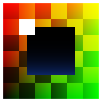

# Hyper Texture Viewer



Fast image viewer for texture artists on Windows. Early prototype.

## What works

- Formats: EXR (half, float and uint; scanline and tiled; every compression including DWAA/DWAB, B44, PXR24 and HTJ2K; layers and multipart), DDS (BC1-BC7 including BC6H, uncompressed formats, mip chains, cubemaps, arrays and volumes), Radiance HDR, PNG (8 and 16 bit; APNG: all frames), JPEG, WebP (animations: all frames), AVIF and JPEG XL (8-16 bit, float, HDR in PQ/HLG, BT.2020 and Display P3 converted for display; sequences and animations: all frames), KTX/KTX2 (mip chains, cubemaps, arrays and volumes, Basis Universal transcoded to BC7), QOI, TGA, BMP, PSD (composite and layers, 8 and 16 bit), GIF (all frames).
- Anything else goes through the codecs installed in Windows (WIC): TIFF, JPEG XR, ICO, camera RAW, and HEIC/HEIF when the Microsoft Store HEIF extension is installed.
- Compressed DDS goes to the GPU as is, so BC textures look exactly as in a game.
- Images of any size the memory takes: those over the GPU's 16384 px texture limit (or over 512 MB) go to the GPU in tiles, drawn seamlessly, with Color match, Compare and the readout working across them.
- Pixels stay sharp when zoomed in (no filtering at 100% and above). Below 100% the mip chain averages the source pixels, so detail does not flicker or alias.
- HDR: exposure, black and white points on a log scale over the image's histogram (Auto picks them from the image), tone mapping (linear clip, Reinhard, ACES, AgX), zebra stripes above the white point, NaN/Inf counted and shown in magenta.
- Single channels, luminance, sRGB or linear interpretation, forced mip level, 3x3 tiling preview. A normal map that seems to have left Z out (two-channel formats such as BC5, or empty blue with red and green around 0.5) gets a warning.
- Alpha over a checkerboard (three sizes), black, grey, white or a custom colour.
- Pixel readout: coordinates, value in nine formats (click to copy), 3x3 and 5x5 averages, locked pixel, pixel grid, rulers (Ctrl+U) in pixels, centimetres or inches at the file's resolution or one set by hand; a dashed outline always marks the pixels the readout reads.
- Histogram panel: RGB overlaid, one channel, luminance or a parade, linear or log counts; HDR images on an axis in stops; mean, min and max per channel.
- Color match (`M`): dashed outline around every pixel within ± N of a target colour, compared by whole colour, one channel, luminance, hue or saturation; pixel count, share of the image and regions, with `,` / `.` to step the view through the regions. Alt+click or the eyedropper picks the target.
- Compare (`Ctrl+K`): up to three images (A is the shown one, B and C are other files) as split shutters you drag on the image, a blend slider, or a difference through a heat ramp with adjustable gain and Max Δ / Mean Δ / Pixels Δ>2 / PSNR.
- Frames (`L` on a GIF, APNG, or animated WebP, AVIF or JPEG XL): play, pause (Space), step (`,` / `.`) and scrub the frames, with the frame delay and loop count; delays play as in browsers (0 or 10 ms as 100 ms).
- Layers (`L` on a file with layers): cube faces, array and volume slices (DDS, KTX), TIFF pages, icon sizes and EXR layers are listed with thumbnails and shown one at a time (`,` / `.` step). PSD layers and groups each have an eye: hiding one composites the rest again (blend modes as Normal), Alt+click shows a layer alone, and with every eye as saved the file's own composite is back.
- Settings (Ctrl+,): theme (dark, light or as Windows), interface scale, viewport colour, checker size, what stays when switching files, folder order, automatic reload, single instance, portable mode, file associations (adds the app to Open with and Windows Default Apps for the current user, with the app icon on the files), and every key reassignable (the F1 screen shows the current keys).
- Info panel (`I`): file, image and format details, EXR header (channels and their types, layers, data and display windows, string and number attributes) and metadata (print resolution, colour profile, EXIF camera, lens, exposure and dates, PNG text, JPEG encoding), each line copied with a click. Keyboard shortcuts screen (F1), light and dark themes, always on top (Ctrl+Shift+T), window opacity and, when on top or below 100%, transparent to mouse (Ctrl+T while the window has the focus), borderless window that hides its bars with Tab.
- The top bar folds its tools into a "..." menu one at a time as the window narrows; the window stops shrinking before anything would overlap.
- Files load in the background with progress; images you leave stay decoded in a cache (size in Settings) and the folder's neighbours are decoded ahead, so Previous/Next is instant; the open file reloads when it changes on disk, a broken file shows what went wrong without stopping browsing. Recent files with thumbnails, paste from the clipboard.
- One exe, static runtime, no installer. Windows 10/11 x64; Direct3D 11 on any GPU, with a software fallback (WARP).

## Controls

All shortcuts are listed in the app under F1. The most used:

| Input | Action |
| --- | --- |
| Mouse wheel | Zoom around the cursor (stops at 100%) |
| Left drag, Space + drag, middle drag | Pan |
| `F`, double click | Fit to window |
| `1` `2` `4` `8` | Zoom 100%, 200%, 400%, 800% |
| Left / Right, PgUp / PgDn, Home / End | Previous / next / first / last image in the folder |
| `R` `G` `B` `A` `Y`, `C` | One channel or luminance (press again to go back), all channels |
| Ctrl + wheel, `-` / `=`, `0` | HDR exposure, reset |
| Ctrl+A, `Z` | Auto range, show clipping |
| Ctrl + click, Ctrl+C | Lock the readout to a pixel, copy its value |
| `T`, Shift+A, Shift+L | Tiling, alpha background, sRGB/linear |
| Right drag, Alt + drag | Move the window |
| Tab, `I`, Ctrl+H, F1, Ctrl+, | Hide bars, info panel, histogram, shortcuts, settings |
| Ctrl+O, Ctrl+V, F5 | Open, paste from clipboard, reload |
| Esc | Close a panel or quit |

Drop a file on the window or pass it on the command line. The viewer never changes the files it shows.

## Building

Visual Studio 2022 and CMake 3.20 or newer. AVIF needs meson, ninja and nasm for dav1d (`pip install meson ninja`, nasm from nasm.us on the PATH), or configure with `-DHTV_WITH_AVIF=OFF`:

```
cmake -S . -B build -A x64
cmake --build build --config Release
ctest --test-dir build -C Release
```

MinGW-w64 works too and produces a static exe. The app icon is `res/htv.ico`, made by `res/make_icon.py` with every size drawn on its own pixel grid: change the script, not the .ico. GitHub Actions builds every push, runs the tests and measures start-up time on sample images (`--bench <file>` writes timings and exits after the first frame).

## Third-party code

| Library | Use | License |
| --- | --- | --- |
| [stb_image, stb_image_write](https://github.com/nothings/stb) | PNG, JPEG, TGA, BMP, PSD, GIF, HDR | Public domain / MIT |
| [libwebp 1.5.0](https://github.com/webmproject/libwebp) | WebP, fetched by CMake | BSD-3-Clause |
| [libavif 1.4.2](https://github.com/AOMediaCodec/libavif) with [dav1d 1.5.3](https://code.videolan.org/videolan/dav1d) | AVIF, fetched by CMake | BSD-2-Clause |
| [libjxl 0.11.1](https://github.com/libjxl/libjxl) (with brotli, highway, lcms2) | JPEG XL, fetched by CMake | BSD-3-Clause (lcms2: MIT) |
| [KTX-Software 4.4.2](https://github.com/KhronosGroup/KTX-Software) | KTX/KTX2 and Basis Universal, fetched by CMake | Apache-2.0 |
| [qoi](https://github.com/phoboslab/qoi) | QOI | MIT |
| [OpenEXR 3.4.9](https://github.com/AcademySoftwareFoundation/openexr) Core (with Imath, libdeflate, OpenJPH) | EXR, fetched by CMake | BSD-3-Clause (libdeflate: MIT, OpenJPH: BSD-2-Clause) |
| [tinyexr 1.0.9](https://github.com/syoyo/tinyexr) | Writes the EXR files the tests read | BSD-3-Clause |

Licenses are in the header files under `third_party/`; the fetched libraries carry theirs in their source trees.
